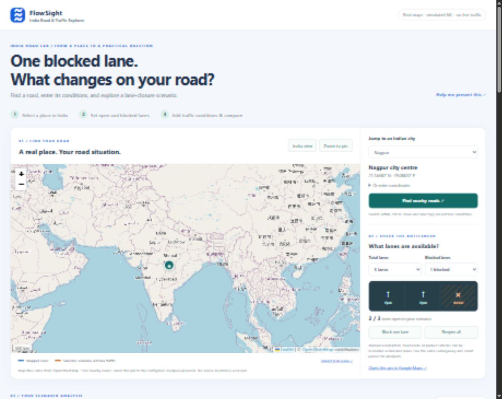

# FlowSight India Road Lab

GitHub repository: [Arnav186/FlowSight](https://github.com/Arnav186/FlowSight)



An interactive React + Leaflet dashboard with a Flask API. Find a place on an India-focused map, enter road conditions, and compare a lane-closure scenario with the same situation when all lanes are open. All four algorithms work together in the analysis.

**Real map geography; manual traffic inputs; simulated ML data.** This is a practical classroom prototype for discussing roadworks, obstructions and lane availability, not a live traffic/navigation service. Selecting a city does not create city-specific traffic measurements.

## Start the presentation

For this prepared local workspace, start from the project root. On a new computer, first follow **Fresh setup or rebuilding** below:

```powershell
python backend/app.py
```

Open **http://127.0.0.1:5000**. Flask serves the built React dashboard and its API on the same address.

Try this demo:

1. Choose **Nagpur**, another city, or click the map. **Zoom to pin** shows local streets. Keyboard users can choose a city or enter coordinates.
2. Click **Find nearby roads**, then choose a road segment. The optional lookup retrieves real OpenStreetMap road geometry and tags within 700 m (up to 40 ways). If the service is unavailable, continue with a manual scenario.
3. Inspect the mapped lane count, if available. It may include both directions: verify it before choosing **Use mapped lanes as my assumption**. Unknown lanes are not guessed.
4. Start with **Morning rush** (3 open lanes), then **Block one lane**. Point to the 2/3 lane diagram, side-by-side KNN delay averages, and 900 vs 600 vehicles per available lane. This ratio is not measured road capacity.
5. The default regression reference is **Same situation · all lanes open**, so only the lane contribution changes. Change rainfall to **8**, and choose **Morning rush** as the reference to also explain the rainfall contribution.
6. Explore traffic groups, switch between **Delay** and **Record count**, inspect similar records and the decision-tree path. **Try reopening all lanes** resets the closure while preserving other inputs.
7. Select **Download scenario** to save the map point, source road ID, manual inputs and comparison as a JSON file. No scenario is published. **Open this pin in Google Maps** opens that location, not a calculated alternative route.

Numeric entry and sliders control vehicle count, speed, rain, incidents and time. The map panel controls total and blocked lanes (1–6 total); choose 10, 30, 60 or 100 similar records. Analysis updates automatically. Presets reset lane assumptions; selecting a different place preserves the manual scenario and clears the previously selected road. All lanes blocked pauses analysis and hides previous results. Invalid or empty inputs show an explanation; stale requests do not overwrite newer inputs.

| Algorithm | Purpose |
|---|---|
| K-Means | Learns three groups from recorded volume, speed, rain, incidents and delay. The UI calls them Light, Busy and Heavy traffic. |
| KNN | Retrieves the closest observations to the six input values after scaling. The displayed group counts and averages use this selected set. |
| Decision Tree | Traverses learned rules using the current inputs and shows the resulting group with its actual decision path. |
| Linear Regression | Shows coefficient × input difference relative to a chosen example. Coefficients remain fixed; contributions change with the inputs. |

## What the numbers mean

- The cards and chart summarize **similar recorded observations**, not future journey times. An absent group shows no average, not zero delay.
- A regression bar is the contribution of **one difference from the reference example**, measured in minutes. It is an association, not proof of a cause. No total delay forecast is shown.
- Group models stay fitted while the user explores. Changing an input selects a new set of similar observations; it does not invent new measurements or retrain the clusters.
- KNN distances are standardized distances, not kilometres or probabilities. The smallest distance is the closest match. Exact matches are retained.
- The tree is a simplified explanation and may disagree with the most common group in the neighbor set.
- The lane comparison retrieves two sets of neighbours using identical inputs except open lanes. It is not a causal estimate of minutes saved. Different lane settings can retain neighbours or yield non-monotonic averages.
- City coordinates and OSM ways are geographic context only. They are not model features; the synthetic records have no GPS or road IDs. Moving the map alone must not invent different traffic results.

## Map services, privacy and limitations

- Leaflet renders standard OpenStreetMap tiles with visible attribution. Internet access is needed for uncached tiles and road lookup; manual analytics uses local model files.
- Road lookup runs only after a button click, through `POST /api/map/roads`. The backend caches up to 64 points for one hour and throttles uncached lookups. Requests have a timeout and bounded response size. Failures do not fabricate roads.
- The app does not request device GPS access. Browsing the map contacts the tile provider; explicit lookup sends the selected coordinates to the configured Overpass provider. Avoid entering private locations if you do not wish to share them. Scenarios are not saved server-side.
- Roads and lane tags can be missing, outdated, split into multiple segments, or count both directions. Select only lanes serving the traffic you observed and use a consistent counting period. Six lanes is the model limit; larger mapped counts are not silently reduced.
- Map bounds are an India-focused viewing window, not a political boundary check. Basemap labels and borders are supplied by OpenStreetMap.
- `OVERPASS_URL` configures the backend provider. `VITE_MAP_TILE_URL` and `VITE_MAP_ATTRIBUTION` configure the frontend tile provider at build time. Keep the required provider attribution and comply with its usage/privacy terms. No automatic provider failover sends coordinates elsewhere.
- This local prototype does not include live traffic, navigation, route optimisation, incident verification, or closure advice. A production application needs licensed/authorised traffic observations linked to road IDs and timestamps, model validation on that data, a production map service, appropriate hosting/security and privacy review. Do not rely on the demo for travel-safety decisions.

Sources: [Leaflet documentation](https://leafletjs.com/reference.html), [OpenStreetMap tile policy](https://operations.osmfoundation.org/policies/tiles/), [Overpass API and public instances](https://wiki.openstreetmap.org/wiki/Overpass_API), [lane tagging](https://wiki.openstreetmap.org/wiki/Key:lanes).

## New code locations

| File | Responsibility |
|---|---|
| `frontend/src/IndiaRoadMap.jsx` | Map, city/coordinate picker, road lookup, lane editor and comparison |
| `frontend/src/roadPlanning.js` | City shortcuts and provenance-labelled scenario export |
| `frontend/src/App.jsx` | Shared inputs linking the map controls to all four model views |
| `frontend/src/roadMap.css` | Responsive map and lane-planner layout |
| `backend/map_service.py` | Validated, bounded, cached Overpass lookup and safe tag parsing |
| `backend/analytics.py` | Existing analytics plus all-lanes-open neighbour comparison |

## Fresh setup or rebuilding

```powershell
pip install -r requirements.txt
python backend/train_models.py
cd frontend
npm ci
npm run build
cd ..
python backend/app.py
```

For frontend development, keep Flask running and start Vite in a second terminal:

```powershell
cd frontend
npm run dev
```

Vite opens at **http://127.0.0.1:5173** and proxies `/api` requests to Flask. Restart an older Flask/Vite process after upgrading this project. The new models use schema version 2; rerun training if the API requests it.

## Verification

```powershell
python -m unittest discover -s backend -p "test_*.py" -v
cd frontend
node --test src/roadPlanning.test.js
npm run build
```

Checks cover scenario changes, aggregation from retrieved synthetic records, exact nearest matches, reference comparisons, lane baselines and zero-lane rejection, map-coordinate validation, unknown/malformed lane tags, upstream errors and caching. Network responses in unit tests are mocked; live provider availability is not guaranteed.

The 2,400 observations are **simulated classroom data**, generated reproducibly with seed 42. They are not live city sensor data. The illustrative group names are ordered by average delay, not municipal congestion thresholds. Small input changes can retain the same nearest records or group label; those numbers should not be forced to move. Hour is a simple numeric feature, so midnight wraparound and non-linear rush-hour patterns are limitations of this small demo.

## Earlier dashboard preview

The earlier traffic-only interface is retained here for reference; the current version includes the map and lane planner shown above.


